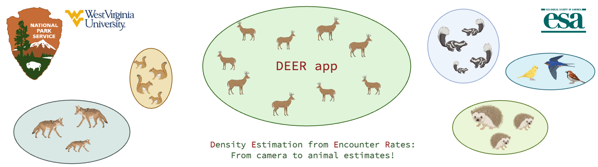
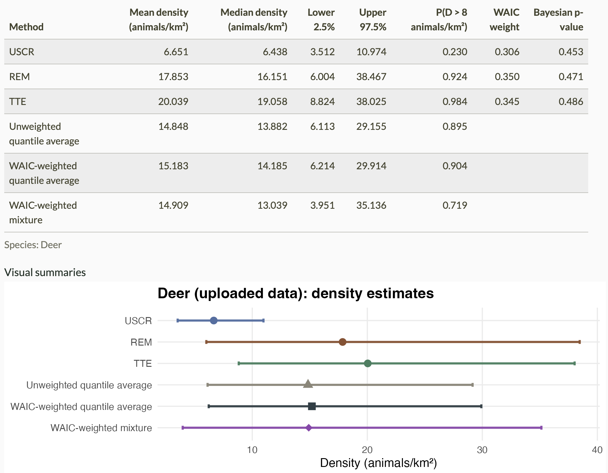

# DEER App



**Density Estimation from Encounter Rates**: a Shiny app for estimating animal density from unmarked camera-trap data.

**Try the app online:** <https://shiny-nps.uri.edu/DEER/>. For long model runs, you may prefer to run it on your own computer (see [Installation](#installation)).

## Overview

The DEER App fits three Bayesian models (USCR, REM, and TTE) to camera-trap data to estimate animal density in animals/km², without requiring individually identifiable animals. Upload deployment and images files, choose a species and priors, and fit each model. On the **Compare & combine** tab, models fit to your data are compared with WAIC and their density estimates combined by model averaging. The **Simulate data** tab simulates data from a study design you choose and fits each model to see how well it recovers the true density.

## Features

- **Three Bayesian models.** The app fits three models with NIMBLE:
  - **USCR** (Unmarked Spatial Capture-Recapture) estimates density from where and how many animals are counted across a camera array.
  - **REM** (Random Encounter Model) converts how often animals pass a camera into density, correcting for movement rate and camera view geometry.
  - **TTE** (Time-to-Event) converts how many animals each camera counts into density, using movement rate to measure camera time in viewshed-crossing time units and correcting for viewshed area.
- **Data checks.** Uploaded deployment and images files are checked for required columns, formats, and consistency. Errors and warnings are clearly described.
- **Priors.** All priors are fully customizable, including informative prior distributions on density.
- **Adaptive runs.** Each run checks convergence and reruns with adjusted settings until every check passes or the adaptive-round limit is reached.
- **Model comparison and averaging.** The app reports WAIC-weighted and unweighted model averages of density with 95% credible intervals, and the probability that density exceeds a threshold you set.
- **Posterior predictive checks.** Each run reports a Bayesian p-value, and failed checks are highlighted.
- **Simulations.** You can simulate data from a camera grid with customizable spacing, survey length, and true density, then compare each model's estimates with the true values.
- **Summaries.** The app provides a camera map, detection summaries, and posterior summaries.

## Installation

### Prerequisites

- R 4.1 or higher
- RStudio (recommended)
- A C++ compiler, which NIMBLE needs to compile the models (Rtools on Windows; the Xcode Command Line Tools on macOS). See the [NIMBLE installation guide](https://r-nimble.org/download.html).

### Required R packages

When the app starts, it installs any missing packages. You can also install them yourself:

```r
install.packages(c(
  "shiny", "bslib", "DT", "ggplot2", "dplyr", "tidyr",
  "readr", "purrr",
  "leaflet", "ggrepel",
  "nimble", "MCMCvis", "lubridate", "sf", "tibble"
))
```

On Linux, `sf` needs the GDAL, GEOS, and PROJ system libraries; see the [sf installation instructions](https://r-spatial.github.io/sf/#installing). On Windows and macOS, the CRAN binaries include them.

### Getting the code

With [Git](https://git-scm.com/):

```bash
git clone https://github.com/nationalparkservice/DEER_App.git
cd DEER_App
```

To update later, run `git pull` in that folder.

Without Git, click **Code → Download ZIP** on the [GitHub repository](https://github.com/nationalparkservice/DEER_App) and unzip it.

### Running the app

Open `app.R` in RStudio and click **Run App**, or, with the project folder as the working directory, run:

```r
shiny::runApp()
```

From the command line:

```bash
Rscript -e "shiny::runApp('/path/to/DEER_App', launch.browser = TRUE)"
```

## Usage

The app's tabs are **About**, **Add your data**, **Data summary**, **Model settings**, **USCR model**, **REM model**, **TTE model**, **Compare & combine**, and **Simulate data**.

### Step 1: Add your data

On the **Add your data** tab, upload a deployment CSV, then an images CSV (see [Data format requirements](#data-format-requirements)). Each upload is checked, and its check log lists any problems. You can also trim each camera's analysis window to a set number of days (24-hour periods) from its start date and time; the trim is off by default and keeps 56 days when turned on. Cleaned copies of both files can be downloaded. To try the app, use the [example data](#example-data).

### Step 2: Review the data summary

The **Data summary** tab summarizes the uploaded data: camera-days and a map of the cameras, detections by species, and counts by site and by day for a selected species.

### Step 3: Choose model settings

On the **Model settings** tab:

- Choose the **species to analyze**. Until you choose one, the app selects the first species in alphabetical order.
- Set the **default detection angle**, used for cameras without a valid `Camera Detection Angle`, and the hemispheres used to correct Latitude and Longitude signs.
- Set the **maximum adaptive rounds** per model run (6 by default).
- Review the **priors**. The default priors are calibrated for white-tailed deer (*Odocoileus virginianus*), and results can be sensitive to them, so think about whether they suit your species and site. Switch to **Advanced** to set an informative density prior (a 95% interval shared by all three models), turn on camera-level noise, or change the other priors and the USCR state-space buffer.

### Step 4: Run the models

Run each model from its own tab (**USCR model**, **REM model**, **TTE model**). The note above each Run button lists any settings that differ from the defaults. While a model runs, a pop-up shows each round's settings and, from the second round on, an estimate of how long the round will take. When it finishes, results appear below the button, and the run-status panel shows each round's checks and any troubleshooting advice.

Anything that changes the data the models are fit to (a new upload, the hemisphere settings, the species, or the trim) clears existing results, so results from different data are never compared or combined.

### Step 5: Compare and combine results

The **Compare & combine** tab summarizes whichever models have been run on the uploaded data: posterior mean, median, and 95% credible interval of density, the probability that density exceeds a threshold you set, WAIC weights, and each model's posterior predictive check (failed checks are highlighted). With two or more models, it also shows model-averaged density. Download the plots (PNG) and posterior summaries for every parameter (CSV) from the same tab. The table, plot titles, and CSV name the species analyzed.



### Simulate data

The **Simulate data** tab is a study-design tool. Choose a camera grid, spacing, survey length, and true density, plus the values each model needs, and click **Simulate data**. Each model gets its own dataset, simulated from that model's own observation model. Then run USCR, REM, and TTE from their sections on the same tab, and compare their estimates and 95% credible intervals with the true values.

- Priors, including their means, come from **Model settings**, as for uploaded data, so you can also see how a fit behaves when its priors are far from the simulated truth.
- USCR's activity centers are simulated within a simulation buffer, set on this tab, that is separate from the fit's state-space buffer in **Model settings**.
- WAIC isn't computed for simulated data, so simulations don't appear on **Compare & combine**.
- Each click simulates one dataset per model, so try several random seeds before drawing conclusions about a design.

## Example data

The `example_dataset/` folder has a deployment file (`SAGA_2026_Deployments.csv`) and an images file (`SAGA_2026_Images.csv`) for trying the app. They come from [Saint-Gaudens National Historical Park](https://www.nps.gov/saga/) (park code SAGA) in Cornish, New Hampshire. The park preserves the home, studios, and gardens of the sculptor Augustus Saint-Gaudens (1848–1907), once the center of the Cornish Art Colony, along with natural areas that visitors explore on its hiking trails.

The survey ran 16 cameras from December 8, 2025, to March 26, 2026. Upload the deployment file, then the images file, on **Add your data**, and choose **Deer** as the species to analyze in **Model settings**. Three cameras malfunctioned before they were picked up, so the check logs also show how the app handles a Camera Malfunction Date.

## File structure

```
DEER_App/
├── app.R                           # Main Shiny app (UI and server)
├── R/
│   ├── sim_and_models.R            # Simulation and model functions (USCR, REM, TTE)
│   └── data_checks.R               # Data checks and summary functions
├── example_dataset/
│   ├── SAGA_2026_Deployments.csv   # Example deployment file
│   └── SAGA_2026_Images.csv        # Example images file
├── images/
│   └── compare_combine.png         # Screenshot of the Compare & combine tab, for this README
├── www/
│   └── deer_app_banner.png         # Banner shown at the top of the app and this README
├── README.md                       # This file
└── deer_app.Rproj                  # RStudio project file
```

## Data format requirements

The app expects data formatted following [TrapTagger](https://wildeyeconservation.org/traptagger/), with the exact column names below. Files from other tagging workflows can usually be renamed to match. The **Add your data** tab has full details, including the checks that block an upload.

The [example data](#example-data) follow this format.

### Deployment file

Required columns:

- **Site Name**: camera site identifier, unique across rows.
- **Start Date / End Date**: deployment dates (`MM/DD/YYYY`).
- **Start Time / End Time**: deployment times (`HH:MM` or `HH:MM:SS`, 24-hour). The columns are required, but a blank or unreadable value is allowed: the analysis window then starts at midnight at the end of Start Date, or ends at midnight at the start of End Date.
- **Latitude / Longitude**: decimal degrees, WGS84 (standard GPS coordinates). Signs are corrected to match the hemispheres set in **Model settings**.
- **Camera Functioning**: `Yes`/`No` (`TRUE`/`FALSE`, `T`/`F`, and `1`/`0` are also accepted).
- **Camera Malfunction Date**: blank for cameras that didn't malfunction. If Camera Functioning is `No`, the first date whose data should be discarded (`MM/DD/YYYY`).
- **Detection Distance**: effective detection radius (meters), a positive number for every camera. REM and TTE depend on it, so a missing, non-numeric, or non-positive value blocks the upload.

Optional columns:

- **Site**, **Camera ID**, **SD Card ID**, **Camera Model**: for recordkeeping.
- **Camera Detection Angle**: full detection angle in degrees, from 5 to 90. A blank or out-of-range value uses the default angle from **Model settings**, with a warning.
- **Camera Height**: in any unit (the models don't use it).
- **Camera Orientation**: cardinal direction (`N`, `NE`, …) or 0–359 degrees.

### Images file

All columns are required except Image URL.

- **Site Name**: must exactly match a Site Name in the deployment file.
- **Timestamp**: image date and time, month/day/year or year-month-day, with an optional 24-hour time. A missing or unreadable Timestamp blocks the upload.
- **Species**: species name. Pipe-delimited values (`deer|squirrel`) are allowed for multi-species rows. A blank Species (for example, a trigger with no animal) is allowed, but the row isn't counted.
- **Cluster ID**: identifier for an independent detection event; any format. Rows from the same event (burst photos, or one row per species) share a Cluster ID. Required on every row with a Species.
- **Sighting Count**: number of animals in the image. Pipe-delimited values (`1|3`) are allowed, in the same order as Species. Required on every row with a Species.
- **Image URL** (optional): image reference or link.

All three models need data from at least 2 cameras. Cross-year surveys (for example, December to January) are supported; the app uses the actual deployment dates and image timestamps.

## Model details

All three models use the number of animals counted at each camera (the sum, over detection events, of each event's largest Sighting Count) and its camera-days (the length of its analysis window, minus time within detection events). Each model tab describes its equations, variables, and default priors.

- **USCR**: estimates abundance in a state space around the cameras from the spatial pattern of counts, using the spatial scale σ and the detection rate λ₀ at an activity center. Density is abundance divided by the state-space area.
- **REM**: models each camera's count from density, daily movement rate, detection radius, and detection angle.
- **TTE**: models each camera's count from density, the number of viewshed-crossing time units per camera-day (from movement rate and the average path length across the viewshed), and viewshed area.

With camera-level noise turned on, each model adds a camera-level random effect, so counts are Poisson-lognormal rather than Poisson.

## Performance notes

- Runs are adaptive. After each round, iterations, burn-in, and thinning double if $\hat{R}$ is above 1.1. M (USCR) or D<sub>max</sub> (REM, TTE) doubles if the posterior presses against it. For USCR, the state-space buffer grows if it is too small. A run stops when every check passes or the adaptive-round limit is reached.
- USCR is the slowest model, especially at high density or with many cameras, since its run time grows roughly with the square of M. REM and TTE are usually much faster.
- MCMC settings (2 chains; starting iterations, burn-in, and thinning) are fixed. Only the maximum adaptive rounds can be changed.

## Troubleshooting

**A model won't run:**
- Check that both uploads passed their checks on **Add your data**.
- Check that a species is selected in **Model settings** and that data come from at least 2 cameras.

**A model reaches the adaptive-round limit without passing every check:**
- Increase **Maximum adaptive rounds** in **Model settings** and rerun. The run-status panel shows which check failed.

**A posterior predictive check fails:**
- If the Bayesian p-value is low (the counts vary more than the model expects), try turning on camera-level noise (**Model settings > Advanced > Priors: Camera-level noise (all models)**).
- If it is high (the counts vary less than the model expects), camera-level noise won't help; interpret that model's estimates with caution.

**Memory issues:**
- Use a smaller dataset or simulation for quick checks.
- Close other R sessions.

## Citation

If you use this app in your research, please cite:

- Van Buskirk, A. et al. (in review).
- USCR: Chandler, R.B. & Royle, J.A. (2013). DOI: [10.1214/12-AOAS610](https://doi.org/10.1214/12-AOAS610)
- REM: Rowcliffe, J.M. et al. (2008). DOI: [10.1111/j.1365-2664.2008.01473.x](https://doi.org/10.1111/j.1365-2664.2008.01473.x)
- TTE: Moeller, A.K. et al. (2018). *Ecosphere* 9(6):e02331. DOI: [10.1002/ecs2.2331](https://doi.org/10.1002/ecs2.2331)

## License

License to be determined.

## Acknowledgments

### Model development

The underlying models and code were created by **Dr. Amanda Van Buskirk** with guidance from [**Dr. Christopher Rota**](https://www.davis.wvu.edu/faculty-staff/directory/christopher-rota) at **West Virginia University, School of Natural Resources and the Environment**.

Scientific collaboration and feedback on model integration and quality control also came from **Dr. Laura C. Gigliotti** (U.S. Geological Survey, West Virginia Cooperative Fish and Wildlife Research Unit, West Virginia University).

<!-- TODO: add a Funding subsection acknowledging NPS funding, once NPS confirms the wording. -->

### Shiny app development

This Shiny app was primarily developed by **PhD Candidate Kacie Ring** as part of the [**SciComm in the Parks fellowship**](https://esa.org/programs/scip/), a collaboration between the **Ecological Society of America (ESA)** and the **National Park Service (NPS)**. **Dr. Christopher Rota** and **Dr. Amanda Van Buskirk** also contributed edits to the app.

**Fellowship support:**
- **Dr. Brian Mitchell** (NPS): Fellowship Liaison
- **Jasjeet Dhanota** (ESA): Mentor
- **Mary Joy Mulumba** (ESA): Program Assistant

## Contact

**Maintainer:** [Dr. Christopher Rota](https://www.davis.wvu.edu/faculty-staff/directory/christopher-rota), West Virginia University

For questions, bug reports, or feature requests, please [open an issue](https://github.com/nationalparkservice/DEER_App/issues) on GitHub. Pull requests are welcome too; for larger changes, please open an issue first so we can discuss them.

---

**DEER App**: Density Estimation from Encounter Rates  
USCR · REM · TTE: three unmarked camera methods for estimating animal density, reported as animals/km².
